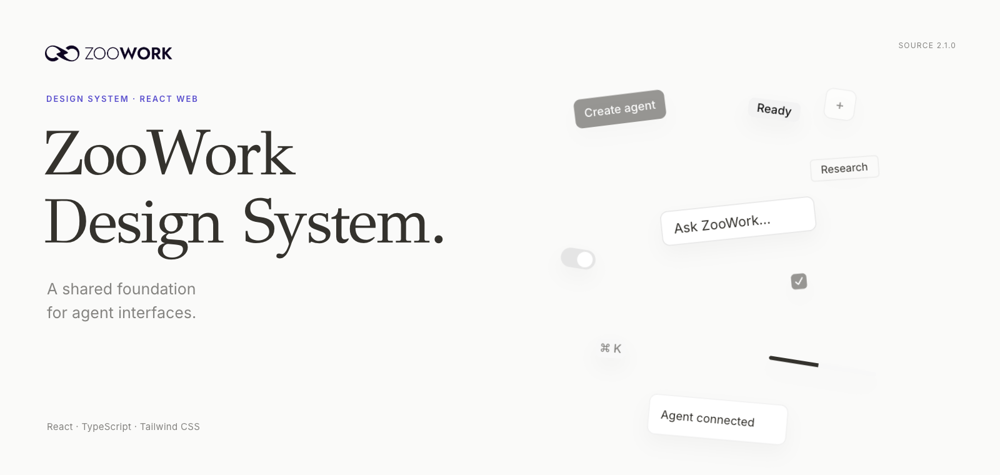

# ZooWorkDesign

为工具和 Agent 搭建清晰、美观、符合直觉的 React Web 界面。

[English](README.md) · [在线预览](https://serendipityoneinc.github.io/ZooWorkDesign/) · [快速开始](docs/QUICK_START.md) · [20 个常用组件](docs/COMPONENTS.md) · [接入指南](docs/CONSUMING.md)



包含基础规范、表单、导航、数据展示、反馈、布局及独立的 Chat Alpha。浅深色主题、类型声明、键盘交互和实际组件示例一起提供；预览与安装包使用同一份实现。

## 安装

基础包适用 React 19 / Tailwind CSS 4；Chat UI 要求 React 与 React DOM >=19.2.7。公开包安装不需要 npm 登录或组织权限。

```bash
pnpm add @zooclaw/zooworkdesign@latest
# 需要聊天界面时添加
pnpm add @zooclaw/zooworkdesign-chat@next
```

在全局 CSS 导入 Tailwind、基础库 `tailwind.css` 和 `brand.css`，在 HTML 根节点设置 `data-brand-theme="paper-focus"`；深色增加 `dark` 类。完整配置、Vite、Next.js 和可运行代码见[接入指南](docs/CONSUMING.md)。

## 让 AI 帮你搭建

在 Codex / Claude Code 打开项目，发送：

```text
使用 https://github.com/SerendipityOneInc/ZooWorkDesign 搭建一个团队任务看板，
包含导航、搜索、任务卡片、状态筛选和创建任务弹窗。
先读 README 和 docs/CONSUMING.md，安装真实组件包，查看 API 与类型，
复用主题与交互。示例数据明确标注，验证构建和关键交互后启动预览。
如果是已有项目，保留现有路由、数据接入与功能。
```

组件提供界面，业务接口、鉴权、路由、上传和持久化由接入项目负责。Chat UI 保持 Alpha；目前没有 iOS / macOS 原生组件库，也不能直接在 Vue 中运行 React 组件。

## 本地开发

```bash
git clone https://github.com/SerendipityOneInc/ZooWorkDesign.git
cd ZooWorkDesign/web
pnpm install --frozen-lockfile
pnpm dev
```

要求 Node 24、pnpm 10.26.2。按终端实际地址打开预览。修改组件后重新 `pnpm build`；真实 tgz 验证使用 `pnpm pack:release` 与 `pnpm verify:consumer`。

基础包使用 `latest`，聊天包使用 `next`。复现线上效果时安装[版本记录](https://serendipityoneinc.github.io/ZooWorkDesign/preview-version.json)中的两个精确版本，并提交消费项目 lockfile。

## 许可与设计资源

代码 Apache 2.0；清单内原创通用素材 CC BY 4.0，署名 **ZooWork Design System · Design by Lynn Zhuang**。字体与第三方代码保留原许可；品牌标识不在通用素材授权中。[许可范围](LICENSING.md) · [第三方署名](THIRD_PARTY_NOTICES.md) · [Figma 状态](docs/FIGMA.md)。

[贡献说明](CONTRIBUTING.md) · [支持范围](docs/SUPPORT.md) · [安全反馈](SECURITY.md)
