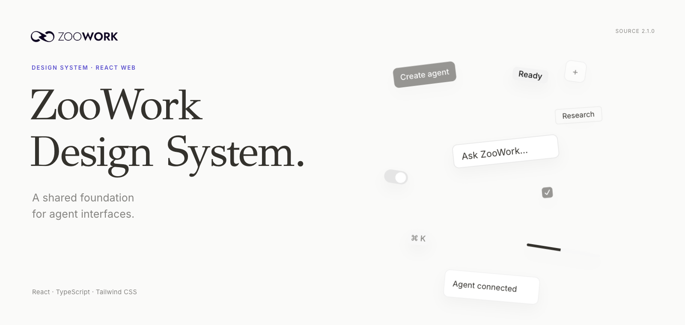

<div align="center">

# ZooWorkDesign

**Build clear, beautiful interfaces for your tools and agents.**

English · [简体中文](README-zh_CN.md)

[Live preview](https://serendipityoneinc.github.io/ZooWorkDesign/) · [Components](docs/COMPONENTS.md) · [Quick start](docs/QUICK_START.md) · [Integration](docs/CONSUMING.md) · [Changelog](web/packages/design-system/CHANGELOG.md)


</div>

[](https://serendipityoneinc.github.io/ZooWorkDesign/)

ZooWorkDesign combines foundations, forms, navigation, data display, feedback, layouts and chat patterns into a shared React Web library. Use individual components or compose a complete workspace. The preview renders the same packages you install.

- Paper Focus light/dark themes, typography, spacing, icons and original illustrations.
- Typed components, keyboard interactions and reusable workspace patterns.
- A separate Chat Alpha package for composers, messages, attachments, pickers and sessions.
- English/Chinese examples, 20 component guides, Vite and Next.js integration.
- Source, notices and exact artwork licensing scope included with each package.

## Install

Use React 19 with matching React DOM and Tailwind CSS 4. Chat requires React and React DOM >=19.2.7. These are public packages; consumers do not need an npm token.

```bash
pnpm add @zooclaw/zooworkdesign@latest
# Optional: Chat UI remains Alpha
pnpm add @zooclaw/zooworkdesign-chat@next
```

```css
@import 'tailwindcss';
@import '@zooclaw/zooworkdesign/tailwind.css';
@import '@zooclaw/zooworkdesign/brand.css';
/* Website components */
@import '@zooclaw/zooworkdesign/marketing.css';
/* If Chat UI is installed */
@import '@zooclaw/zooworkdesign-chat/tailwind.css';
```

Set `data-brand-theme="paper-focus"` on your HTML root; add `class="dark"` for dark mode. Configure Tailwind's Vite or PostCSS plugin. Read [integration](docs/CONSUMING.md) for the complete setup.

```tsx
import { Button, Card, CardContent, CardHeader, CardTitle } from '@zooclaw/zooworkdesign'

export function AgentCard() {
  return <Card>
    <CardHeader><CardTitle>Market brief</CardTitle></CardHeader>
    <CardContent><Button>Open agent</Button></CardContent>
  </Card>
}
```

## Build with Codex or Claude Code

Open your project and give your agent this prompt:

```text
Use https://github.com/SerendipityOneInc/ZooWorkDesign to build a team task board.
Include navigation, search, task cards, status filters and a create-task dialog.
Read README.md and docs/CONSUMING.md, install the actual component packages,
and inspect their APIs and types. Reuse the theme and interactions, use clearly
labelled sample data, verify the build and key interactions, then start a preview.
For an existing app, preserve its routes, data integration and working features.
```

The library provides UI. Authentication, business permissions, APIs, routing, uploads and persistence belong to your application. Native iOS/macOS and Vue components are not included. See [support](docs/SUPPORT.md).

## Packages

| Package | Channel | Content |
| --- | --- | --- |
| `@zooclaw/zooworkdesign` | `latest` | Foundations, components, layouts and themes |
| `@zooclaw/zooworkdesign-chat` | `next` | Chat UI Alpha; APIs may change |

To reproduce the live preview, install both exact versions from [preview-version.json](https://serendipityoneinc.github.io/ZooWorkDesign/preview-version.json). PR previews use `preview` / `pr-N`. Update and commit your application's lockfile deliberately.

## Develop locally

```bash
git clone https://github.com/SerendipityOneInc/ZooWorkDesign.git
cd ZooWorkDesign/web
pnpm install --frozen-lockfile
pnpm dev
```

Use Node 24 and pnpm 10.26.2. Vite prints the local URL. The catalog consumes compiled public entrypoints; rebuild the packages after editing their source.

```bash
pnpm build
pnpm typecheck
pnpm lint
pnpm test
pnpm test:release
pnpm build:preview
pnpm pack:release
pnpm verify:consumer
```

Consumers can also build from source and install both generated tgz files; see [integration](docs/CONSUMING.md). CI verifies real package installation, CSS, assets, keyboard interactions and Next.js server/client boundaries.

## Design resources and licenses

- Code and CSS: [Apache-2.0](LICENSE).
- Explicitly listed original artwork: [CC BY 4.0](DESIGN_ASSETS.md), credited to **ZooWork Design System · Design by Lynn Zhuang**.
- Fonts and third-party code retain their original licenses and authorship: [notices](THIRD_PARTY_NOTICES.md), [scope](LICENSING.md).
- Brand marks are excluded from the general artwork grant. [Figma resources](docs/FIGMA.md) are released separately; this repository does not claim Community publication before it is verified.

[Contributing](CONTRIBUTING.md) · [Security](SECURITY.md) · [Theming](docs/THEMING.md) · [Publishing](docs/PUBLISHING.md)
